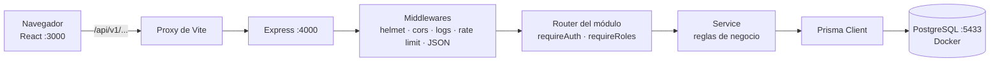
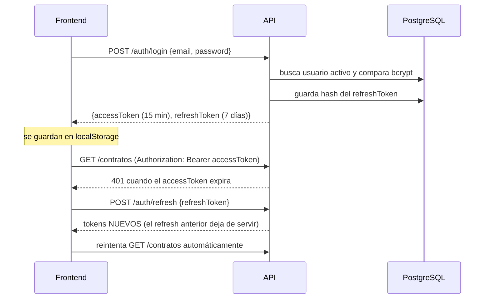
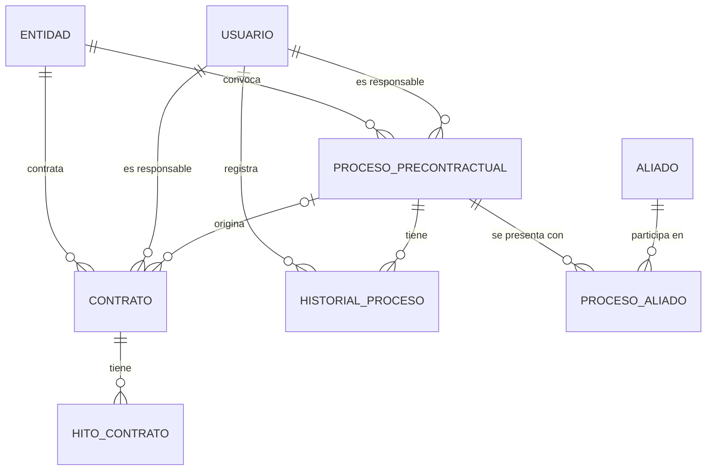
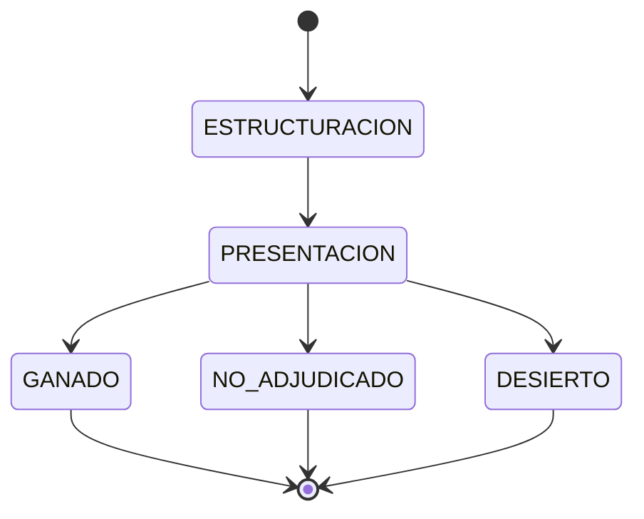

# TechTransit

Sistema web para gestionar la **contratación pública colombiana** de la empresa: desde que se prepara una
licitación (etapa precontractual) hasta la ejecución y seguimiento de los contratos ganados.

> ¿Primera vez en el proyecto? Lee este README completo (≈15 min) y luego sigue
> [Puesta en marcha](#3-puesta-en-marcha-en-5-pasos). Para el detalle paso a paso del entorno local
> (DBeaver, solución de problemas, etc.) está la guía [docs/DESARROLLO.md](docs/DESARROLLO.md)
> (también en [PDF](docs/DESARROLLO.pdf)).

---

## Índice

1. [¿Qué hace el sistema?](#1-qué-hace-el-sistema)
2. [Tecnologías](#2-tecnologías)
3. [Puesta en marcha en 5 pasos](#3-puesta-en-marcha-en-5-pasos)
4. [Cómo está organizado el código](#4-cómo-está-organizado-el-código)
5. [Cómo funciona por dentro](#5-cómo-funciona-por-dentro)
6. [Modelo de datos](#6-modelo-de-datos)
7. [Reglas de negocio](#7-reglas-de-negocio)
8. [API REST](#8-api-rest)
9. [Guía práctica: agregar un módulo nuevo](#9-guía-práctica-agregar-un-módulo-nuevo)
10. [Scripts disponibles](#10-scripts-disponibles)
11. [Flujo de trabajo con Git](#11-flujo-de-trabajo-con-git)
12. [Errores comunes](#12-errores-comunes)
13. [Glosario](#13-glosario)
14. [Estado del proyecto y pendientes](#14-estado-del-proyecto-y-pendientes)

---

## 1. ¿Qué hace el sistema?

| Módulo | Para qué sirve |
|---|---|
| **Dashboard** | Indicadores (KPIs) en tiempo real: procesos activos, contratos en ejecución, contratos en riesgo, valores en pesos. |
| **Precontractual** | Tablero Kanban de las licitaciones en las que participa la empresa, desde que se estructuran hasta que se ganan o se pierden. |
| **Contratos** | Seguimiento de los contratos ganados: avance físico y financiero, hitos (entregables con fecha) y un **semáforo** de riesgo. |
| **Catálogos** | Datos maestros: entidades contratantes, aliados (socios de consorcio) y usuarios. |
| **Notificaciones** | Alertas automáticas: contratos en rojo, contratos por vencer, hitos vencidos y licitaciones por cerrar. |

Hay tres **roles** de usuario:

| Rol | Puede |
|---|---|
| `ADMIN` | Todo, incluida la gestión de usuarios y borrar registros. |
| `SUPERVISOR` | Crear y editar procesos, contratos, hitos, entidades y aliados. |
| `COLABORADOR` | Solo consultar. |

---

## 2. Tecnologías

| Capa | Tecnología | Versión | ¿Para qué? |
|---|---|---|---|
| Runtime | Node.js | 24 | Ejecuta el backend y las herramientas. |
| Backend | Express | 5 | Servidor HTTP / API REST. |
| ORM | Prisma | 7 | Acceso a la base de datos con tipos de TypeScript y migraciones. |
| Validación | Zod | 4 | Valida lo que llega en cada petición y las variables de entorno. |
| Auth | JWT (`jsonwebtoken`) + `bcrypt` | — | Tokens de sesión y contraseñas cifradas. |
| Logs | pino | 10 | Logs estructurados (JSON en producción, legibles en desarrollo). |
| Base de datos | PostgreSQL | 17 | En desarrollo corre en Docker. |
| Frontend | React | 19 | Interfaz de usuario. |
| Bundler | Vite | 8 | Servidor de desarrollo y build del frontend. |
| Estilos | Tailwind CSS | 4 | Utilidades CSS + variables propias en `globals.css`. |
| Rutas | React Router | 7 | Navegación entre páginas. |
| Estado | Zustand | 5 | Estado global (sesión del usuario). |
| HTTP | Axios | 1 | Llamadas al API, con renovación automática del token. |
| Lenguaje | TypeScript | 5.9 | En todo el proyecto. |
| Calidad | ESLint 9 + Prettier 3 | — | Reglas de código y formato. |

Es un **monorepo** con *npm workspaces*: un solo repositorio y un solo `npm ci` para `backend/` y `frontend/`.

---

## 3. Puesta en marcha en 5 pasos

**Necesitas:** Node.js 24, Docker (con Docker Compose) y Git. En Windows, trabaja dentro de **WSL2**.

```bash
# 1. Instalar dependencias (backend + frontend a la vez)
npm ci

# 2. Levantar PostgreSQL en Docker (puerto 5433)
npm run db:up

# 3. Crear el archivo de configuración del backend
cp backend/.env.development.example backend/.env

# 4. Crear las tablas, generar el cliente de Prisma y cargar usuarios de prueba
npm run db:setup -w backend

# 5. Arrancar (en dos terminales distintas)
npm run start:dev -w backend     # API      → http://localhost:4000/api/v1/health
npm run dev -w frontend          # Frontend → http://localhost:3000
```

Entra a <http://localhost:3000> con alguno de estos usuarios (solo existen en tu base local):

| Rol | Email | Contraseña |
|---|---|---|
| ADMIN | `admin@techtransit.dev` | `Admin1234!` |
| SUPERVISOR | `supervisor@techtransit.dev` | `Super1234!` |
| COLABORADOR | `colaborador@techtransit.dev` | `Colab1234!` |

**Ver la base de datos con DBeaver:** PostgreSQL → host `localhost`, puerto `5433`, base `techtransit`,
usuario `techtransit`, contraseña `techtransit`. Paso a paso en [docs/DESARROLLO.md §4](docs/DESARROLLO.md#4-conectarse-a-la-base-de-datos-con-dbeaver).

> **¿Por qué el puerto 5433 y no el 5432?** Para no chocar con otro PostgreSQL que tengas instalado.
> Se puede cambiar con `DB_PORT=5434 npm run db:up` (y ajustar la URL en `backend/.env`).

---

## 4. Cómo está organizado el código

```
techtransit/
├── backend/                      ← API REST (Express + Prisma)
│   ├── prisma.config.ts          ← configuración del CLI de Prisma (migraciones, seed)
│   ├── prisma/
│   │   ├── schema.prisma         ← ⭐ definición de TODAS las tablas (fuente de verdad)
│   │   ├── migrations/           ← historial de cambios de la BD (SQL generado, no editar a mano)
│   │   └── seed.ts               ← usuarios de prueba
│   └── src/
│       ├── server.ts             ← punto de entrada: conecta a la BD y arranca el servidor
│       ├── app.ts                ← arma Express: seguridad, logs, rate limit, rutas
│       ├── config/
│       │   ├── env.ts            ← lee y valida variables de entorno (.env)
│       │   └── logger.ts         ← logger pino
│       ├── db/prisma.ts          ← única instancia del cliente de base de datos
│       ├── generated/prisma/     ← cliente Prisma generado (NO se sube a git)
│       ├── lib/
│       │   ├── pagination.ts     ← helper de paginación estándar
│       │   └── fechas.ts         ← helpers para fechas de calendario (ver §7.4)
│       ├── middleware/
│       │   ├── auth.ts           ← requireAuth: exige token JWT válido
│       │   ├── roles.ts          ← requireRoles('ADMIN', ...): exige un rol
│       │   └── error.ts          ← manejador global de errores + createError()
│       ├── types/express.d.ts    ← agrega req.user al tipo Request de Express
│       └── modules/              ← ⭐ un directorio por funcionalidad
│           └── <modulo>/
│               ├── <modulo>.router.ts   ← rutas HTTP (qué URL, qué rol, qué servicio)
│               ├── <modulo>.schemas.ts  ← validaciones Zod de lo que entra
│               └── <modulo>.service.ts  ← lógica de negocio y consultas a la BD
│
├── frontend/                     ← SPA (React + Vite)
│   ├── vite.config.ts            ← puerto de desarrollo y proxy /api → backend
│   └── src/
│       ├── main.tsx              ← punto de entrada de React
│       ├── App.tsx               ← definición de rutas (páginas)
│       ├── pages/                ← ⭐ una página por módulo (DashboardPage, ContratosPage, ...)
│       ├── components/           ← componentes reutilizables (layout y UI)
│       ├── layouts/AppLayout.tsx ← estructura con barra lateral para páginas autenticadas
│       ├── router/ProtectedRoute.tsx ← redirige a /login si no hay sesión
│       ├── store/authStore.ts    ← sesión del usuario (Zustand)
│       ├── lib/
│       │   ├── api.ts            ← cliente Axios con token y renovación automática
│       │   ├── api.<modulo>.ts   ← funciones y tipos para llamar a cada módulo del API
│       │   ├── tokenStorage.ts   ← guarda los tokens en localStorage
│       │   └── fechas.ts         ← formatear fechas y calcular días restantes
│       └── styles/globals.css    ← Tailwind + variables de diseño (colores, espacios)
│
├── docs/                         ← documentación (guía de desarrollo, alcance)
├── database/schema.sql           ← ⚠ HISTÓRICO, no usar (la verdad está en schema.prisma)
├── docker-compose.yml            ← PostgreSQL para desarrollo
├── render.yaml                   ← ⚠ HISTÓRICO, ya no se despliega en Render
└── .github/workflows/ci.yml      ← CI: lint + build en cada push/PR a main
```

**Regla de oro del backend:** el *router* solo recibe la petición, valida con el *schema* y llama al
*service*. Toda la lógica (reglas, consultas, cálculos) va en el *service*.

---

## 5. Cómo funciona por dentro

### 5.1 Vista general



En desarrollo el frontend llama a rutas relativas (`/api/v1/...`) y **Vite las reenvía** al backend.
Por eso no hace falta configurar CORS ni URLs en el frontend.

### 5.2 Recorrido de una petición (ejemplo: crear una entidad)

1. El usuario llena el formulario en `CatalogosPage.tsx` y se llama `entidadesApi.create(payload)` (`lib/api.catalogos.ts`).
2. Axios (`lib/api.ts`) agrega el header `Authorization: Bearer <accessToken>` y envía `POST /api/v1/entidades`.
3. En el backend, `app.ts` aplica seguridad, logs y *rate limit*, y entrega la petición a `entidades.router.ts`.
4. El router ejecuta `requireAuth` (¿token válido?) y `requireRoles('ADMIN', 'SUPERVISOR')` (¿rol permitido?).
5. `createEntidadSchema.parse(req.body)` valida los datos. Si algo está mal, Zod lanza un error y el usuario recibe **400** con el detalle por campo.
6. `createEntidad()` en `entidades.service.ts` guarda en la base con Prisma.
7. Se responde **201** con la entidad creada. Si en cualquier paso ocurre un error, `middleware/error.ts` lo convierte en una respuesta JSON consistente.

### 5.3 Autenticación (login y sesión)



- El **access token** dura poco (15 min) y viaja en cada petición. Contiene `sub` (id), `email` y `rol`.
- El **refresh token** dura 7 días y solo sirve para pedir tokens nuevos. Se **rota** en cada uso
  y en la BD solo se guarda su *hash*.
- La renovación es automática: el interceptor de `lib/api.ts` detecta el 401, pide tokens nuevos y
  repite la petición. Si el refresh falla, se envía al usuario a `/login`.
- Al recargar la página, `authStore.hydrate()` valida la sesión con un refresh silencioso.

### 5.4 Formato de respuestas

**Listados** (todas las rutas `GET /<recurso>`) devuelven siempre:

```json
{ "items": [ ... ], "total": 42, "page": 1, "limit": 50, "pages": 1 }
```

Se controlan con `?page=2&limit=20` (máximo 200 por página; 500 en procesos).

**Errores** devuelven siempre un `message`:

```json
{ "message": "Datos de entrada inválidos",
  "errors": { "nombre": ["Too small: expected string to have >=3 characters"] } }
```

| Código | Significado |
|---|---|
| 400 | Datos inválidos (Zod), JSON mal formado o transición de estado no permitida. |
| 401 | Falta el token o está vencido. |
| 403 | El rol del usuario no tiene permiso. |
| 404 | El recurso no existe. |
| 409 | Conflicto (p. ej. email ya registrado). |
| 429 | Demasiadas peticiones (ver *rate limit* abajo). |
| 500 | Error interno; el detalle solo aparece en los logs del servidor. |

**Rate limit:** 200 peticiones / 15 min por IP en general, y **20 / 15 min** en `/auth/*`
(para frenar ataques a contraseñas).

---

## 6. Modelo de datos

La definición completa está en [backend/prisma/schema.prisma](backend/prisma/schema.prisma).



| Tabla | Qué guarda |
|---|---|
| `entidad` | Entidades públicas que contratan (alcaldías, gobernaciones, ministerios...). NIT único. |
| `usuario` | Usuarios del sistema con su rol. La contraseña se guarda cifrada (`password_hash`). |
| `aliado` | Empresas socias con las que se arman consorcios o uniones temporales. |
| `proceso_precontractual` | Cada licitación en la que se participa, con su estado en el Kanban. |
| `proceso_aliado` | Qué aliados participan en cada proceso, con rol y porcentaje de participación. |
| `historial_proceso` | Bitácora de cada cambio de estado de un proceso: quién, cuándo y comentario. |
| `contrato` | Contratos en ejecución: valores, avance, fechas, supervisor y semáforo. |
| `hito_contrato` | Entregables o pagos de un contrato, con fecha límite y estado. |
| `_prisma_migrations` | Uso interno de Prisma. **No tocar.** |

**Convenciones:**
- En TypeScript los campos van en `camelCase` (`fechaFin`) y en la BD en `snake_case` (`fecha_fin`). Prisma traduce con `@map`.
- Los IDs son UUID generados por Prisma.
- El dinero es `Decimal(18,2)`, en pesos colombianos (COP).
- Las fechas de calendario (`fechaInicio`, `fechaFin`, `fechaLimite`...) son tipo `DATE`, sin hora. Ver §7.4.
- **Borrado lógico:** el `DELETE` de entidades, aliados, usuarios y contratos no borra la fila, solo pone `activo = false` (así no se rompe el historial). Los procesos y los hitos sí se borran definitivamente.

---

## 7. Reglas de negocio

### 7.1 Estados de un proceso precontractual (Kanban)



- Solo se permiten las flechas del diagrama. Cualquier otro cambio responde **400**
  (`TRANSICIONES` en `procesos.service.ts`).
- `GANADO`, `NO_ADJUDICADO` y `DESIERTO` son **finales**: el proceso ya no cambia de estado.
- Cada cambio queda en `historial_proceso`, dentro de una transacción.

### 7.2 Semáforo de un contrato

Se calcula automáticamente al crear o editar el contrato (`calcularSemaforo` en `contratos.service.ts`):

| Resultado | Condición |
|---|---|
| 🟢 `VERDE` | Terminó (`fechaFinReal`) a tiempo, **o** va al día. |
| 🔴 `ROJO` | Ya pasó la fecha de fin sin terminar, **o** le quedan **15 días o menos**, **o** el avance físico va **más de 20 puntos** por debajo de lo esperado. |
| 🟡 `AMARILLO` | El avance físico va **entre 10 y 20 puntos** por debajo de lo esperado. |

El *avance esperado* es el porcentaje del año (desde el 1 de enero del año de `fechaFin`) que ya
transcurrió. Un SUPERVISOR o ADMIN también puede fijar el semáforo **a mano**
(`PATCH /contratos/:id/semaforo`), pero se vuelve a calcular en la siguiente edición del contrato.

### 7.3 Notificaciones automáticas

No se guardan en la BD: se **calculan al consultarlas** (`notificaciones.service.ts`).

| Alerta | Severidad | Cuándo aparece |
|---|---|---|
| Contrato en riesgo | 🔴 danger | Contrato activo con semáforo ROJO. |
| Hito vencido | 🔴 danger | Hito `PENDIENTE` o `EN_PROGRESO` con fecha límite anterior a hoy. |
| Contrato por vencer | 🟡 warning | Contrato VERDE o AMARILLO que termina en los próximos 30 días. |
| Proceso por cerrar | 🔵 info | Licitación en estructuración o presentación que cierra en los próximos 15 días. |

### 7.4 Fechas: cuidado con la zona horaria ⚠

Las columnas `DATE` llegan del API como `"2027-06-30T00:00:00.000Z"` (medianoche UTC). Si en el
frontend haces `new Date(fecha).toLocaleDateString()`, en Colombia (UTC−5) se muestra **un día antes**.

- **Frontend:** usa siempre `fmtFecha()` y `diasHasta()` de `src/lib/fechas.ts`.
- **Backend:** para comparar con "hoy", usa `hoyFecha()` de `src/lib/fechas.ts`. Da la fecha
  actual de Colombia aunque el servidor esté en UTC. **No uses `new Date()`** para comparar
  con columnas de fecha.
- **Formularios:** un `<input type="date">` entrega `"YYYY-MM-DD"`; envíalo tal cual al API.

---

## 8. API REST

Base: `/api/v1`. Todas las rutas, salvo `health` y `auth` (excepto `logout`), exigen
`Authorization: Bearer <accessToken>`.

| Método | Ruta | Rol mínimo | Descripción |
|---|---|---|---|
| GET | `/health` | público | Estado del servidor. |
| POST | `/auth/register` | público | Crea usuario (rol COLABORADOR) y devuelve tokens. ⚠ Ver §14. |
| POST | `/auth/login` | público | `{email, password}` → tokens. |
| POST | `/auth/refresh` | público | `{refreshToken}` → tokens nuevos. |
| POST | `/auth/logout` | autenticado | Invalida el refresh token. |
| GET | `/dashboard/kpis` | autenticado | KPIs del dashboard. |
| GET | `/procesos` | autenticado | Lista. Filtros: `estado`, `entidadId`, `responsableId`, `modalidad`. |
| GET | `/procesos/:id` | autenticado | Detalle con aliados e historial. |
| POST · PUT | `/procesos` · `/procesos/:id` | SUPERVISOR | Crear / editar. |
| PATCH | `/procesos/:id/estado` | SUPERVISOR | Mover en el Kanban `{estado, comentario?}`. |
| DELETE | `/procesos/:id` | ADMIN | Eliminar (borrado definitivo, incluye historial). |
| GET | `/contratos` | autenticado | Lista. Filtros: `semaforo`, `entidadId`, `responsableId`, `activo`. |
| GET | `/contratos/:id` | autenticado | Detalle con hitos. |
| POST · PUT | `/contratos` · `/contratos/:id` | SUPERVISOR | Crear / editar (recalcula el semáforo). |
| PATCH | `/contratos/:id/semaforo` | SUPERVISOR | Fijar semáforo manualmente. |
| DELETE | `/contratos/:id` | ADMIN | Desactivar (`activo = false`). |
| POST | `/contratos/:id/hitos` | SUPERVISOR | Agregar hito. |
| PUT · DELETE | `/contratos/:id/hitos/:hitoId` | SUPERVISOR | Editar / eliminar hito (borrado definitivo). |
| GET | `/entidades` · `/aliados` | autenticado | Listas (`?todas=true` / `?todos=true` incluye inactivos). |
| GET | `/entidades/:id` · `/aliados/:id` | autenticado | Detalle. |
| POST · PUT | `/entidades` · `/aliados` (`/:id`) | SUPERVISOR | Crear / editar. |
| DELETE | `/entidades/:id` · `/aliados/:id` | ADMIN | Desactivar (`activo = false`). |
| GET · POST · PUT · DELETE | `/usuarios` (`/:id`) | ADMIN | Gestión de usuarios (DELETE desactiva). |
| GET | `/notificaciones` · `/notificaciones/conteo` | autenticado | Alertas y su cantidad. |

"SUPERVISOR" como rol mínimo significa SUPERVISOR **o** ADMIN.

**Probar el API desde la terminal:**

```bash
# Login y guardar el token en una variable
TOKEN=$(curl -s -X POST localhost:4000/api/v1/auth/login \
  -H 'content-type: application/json' \
  -d '{"email":"admin@techtransit.dev","password":"Admin1234!"}' | node -pe 'JSON.parse(require("fs").readFileSync(0)).accessToken')

# Usarlo
curl -s localhost:4000/api/v1/entidades -H "Authorization: Bearer $TOKEN"
```

---

## 9. Guía práctica: agregar un módulo nuevo

Ejemplo: un módulo **`polizas`** (pólizas de garantía de un contrato).

**1. Modelo en la base de datos.** Agrega el modelo en `backend/prisma/schema.prisma`:

```prisma
model Poliza {
  id          String   @id @default(uuid())
  contratoId  String   @map("contrato_id")
  aseguradora String
  numero      String   @unique
  vigenciaFin DateTime @map("vigencia_fin") @db.Date
  createdAt   DateTime @default(now()) @map("created_at")
  updatedAt   DateTime @updatedAt @map("updated_at")

  contrato Contrato @relation(fields: [contratoId], references: [id], onDelete: Cascade)

  @@map("poliza")
}
```

Agrega también `polizas Poliza[]` dentro de `model Contrato`, y luego crea la migración:

```bash
npm run db:migrate -w backend -- --name agrega_polizas
```

Esto crea `prisma/migrations/<fecha>_agrega_polizas/`, la aplica a tu BD local y regenera el cliente.

**2. Validaciones** → `backend/src/modules/polizas/polizas.schemas.ts`

```ts
import { z } from 'zod';

export const createPolizaSchema = z.object({
  contratoId:  z.uuid(),
  aseguradora: z.string().min(2).max(200),
  numero:      z.string().min(1).max(100),
  vigenciaFin: z.iso.date(),          // "YYYY-MM-DD"
});
```

**3. Lógica** → `polizas.service.ts`

```ts
import type { z } from 'zod';
import { prisma } from '../../db/prisma';
import { paginate, type PaginationParams } from '../../lib/pagination';
import type { createPolizaSchema } from './polizas.schemas';

export async function listPolizas({ page, limit }: PaginationParams) {
  const [items, total] = await Promise.all([
    prisma.poliza.findMany({ orderBy: { vigenciaFin: 'asc' }, skip: (page - 1) * limit, take: limit }),
    prisma.poliza.count(),
  ]);
  return paginate(items, total, page, limit);
}

export async function createPoliza(data: z.infer<typeof createPolizaSchema>) {
  return prisma.poliza.create({ data: { ...data, vigenciaFin: new Date(data.vigenciaFin) } });
}
```

**4. Rutas** → `polizas.router.ts` (mismo patrón que `entidades.router.ts`)

```ts
import { Router } from 'express';
import { requireAuth } from '../../middleware/auth';
import { requireRoles } from '../../middleware/roles';
import { paginationSchema } from '../../lib/pagination';
import { createPolizaSchema } from './polizas.schemas';
import { listPolizas, createPoliza } from './polizas.service';

const router = Router();
router.use(requireAuth);

router.get('/', async (req, res, next) => {
  try {
    res.json(await listPolizas(paginationSchema.parse(req.query)));
  } catch (err) { next(err); }
});

router.post('/', requireRoles('ADMIN', 'SUPERVISOR'), async (req, res, next) => {
  try {
    res.status(201).json(await createPoliza(createPolizaSchema.parse(req.body)));
  } catch (err) { next(err); }
});

export default router;
```

**5. Registrar las rutas** en `backend/src/app.ts`:

```ts
import polizasRouter from './modules/polizas/polizas.router';
// ...
app.use('/api/v1/polizas', polizasRouter);
```

**6. Frontend:**
- `frontend/src/lib/api.polizas.ts`: tipos e interfaz `polizasApi` con funciones `list()` y `create()` usando `api` (ver `api.catalogos.ts`).
- `frontend/src/pages/PolizasPage.tsx`: la página.
- `frontend/src/App.tsx`: `<Route path="/polizas" element={<PolizasPage />} />` dentro de las rutas protegidas.
- `frontend/src/components/layout/Sidebar.tsx`: el enlace en el menú.

**7. Verificar** antes de hacer commit: `npm run lint && npm run build`.

**Para errores esperados usa `createError`**, no `res.status()` dentro del service:

```ts
import { createError } from '../../middleware/error';
if (!poliza) throw createError('Póliza no encontrada', 404);
```

---

## 10. Scripts disponibles

Se ejecutan desde la **raíz** del repositorio.

| Comando | Qué hace |
|---|---|
| `npm run db:up` | Levanta PostgreSQL en Docker y espera a que esté listo. |
| `npm run db:down` | Detiene PostgreSQL (los datos se conservan). |
| `npm run db:logs` | Muestra los logs de PostgreSQL. |
| `npm run db:reset` | ⚠ **Borra todos los datos** y deja la BD vacía. Después: `npm run db:setup -w backend`. |
| `npm run db:setup -w backend` | Aplica migraciones, genera el cliente y carga el seed. |
| `npm run db:migrate -w backend -- --name <nombre>` | Crea y aplica una migración tras editar `schema.prisma`. |
| `npm run db:generate -w backend` | Regenera el cliente Prisma (tras `git pull` con cambios en el schema). |
| `npm run db:seed -w backend` | Vuelve a cargar los usuarios de prueba. |
| `npm run db:studio -w backend` | Abre Prisma Studio (ver y editar datos en el navegador). |
| `npm run start:dev -w backend` | API con recarga automática al guardar. |
| `npm run dev -w frontend` | Frontend con recarga automática. |
| `npm run lint` | Revisa el código de backend y frontend. |
| `npm run build` | Compila backend (`backend/dist`) y frontend (`frontend/dist`). |
| `npm run format` | Formatea el código con Prettier. |

---

## 11. Flujo de trabajo con Git

1. Actualiza `main`: `git checkout main && git pull`.
2. Crea una rama: `git checkout -b feat/nombre-corto` (o `fix/...`, `chore/...`, `docs/...`).
3. Haz commits pequeños con mensajes del estilo [Conventional Commits](https://www.conventionalcommits.org/es/):
   `feat(contratos): agrega filtro por supervisor`, `fix(frontend): ...`.
4. Antes de subir: `npm run lint && npm run build`.
5. `git push -u origin feat/nombre-corto` y abre un Pull Request hacia `main`.
6. El CI de GitHub Actions corre lint y build; debe quedar en verde.

**Después de `git pull`**, si cambiaron `package-lock.json` o `schema.prisma`:

```bash
npm ci
npm run db:setup -w backend    # aplica migraciones nuevas, regenera el cliente y re-ejecuta el seed
```

**Nunca subas** `backend/.env` ni tokens o contraseñas reales. `.gitignore` ya excluye `.env`.

---

## 12. Errores comunes

| Síntoma | Solución |
|---|---|
| `Variables de entorno inválidas` al arrancar el backend | Falta `backend/.env` o un secreto JWT tiene menos de 32 caracteres → paso 3 de §3. |
| `Can't reach database server` / `P1001` | La BD no está corriendo → `npm run db:up`. |
| `Cannot find module '../generated/prisma/client'` | Falta generar el cliente → `npm run db:generate -w backend`. |
| `port is already allocated` (5433) | Otro proceso usa el puerto → `DB_PORT=5434 npm run db:up` y ajusta `backend/.env`. |
| `Port 3000 is already in use` | `VITE_PORT=3100 npm run dev -w frontend` y pon `FRONTEND_URL=http://localhost:3100` en `backend/.env`. |
| Login responde 429 | Límite de intentos de auth; espera 15 min o reinicia el backend. |
| Pantalla en blanco con `Invalid hook call` | `rm -rf frontend/node_modules/.vite && npm ci`. |
| Una fecha se ve un día antes | Estás usando `new Date()` directo; usa `lib/fechas.ts` (§7.4). |

Más casos en [docs/DESARROLLO.md §7](docs/DESARROLLO.md#7-solución-de-problemas).

---

## 13. Glosario

| Término | Significado |
|---|---|
| **Entidad** | Entidad pública que abre la licitación y contrata (p. ej. una gobernación). |
| **Proceso precontractual** | Etapa antes de firmar el contrato: preparar y presentar la oferta a una licitación. |
| **Estructuración** | Se está armando la oferta (documentos, precios, aliados). |
| **Presentación** | La oferta ya se entregó y se espera el resultado. |
| **Adjudicación** | La entidad elige al ganador. *No adjudicado* = ganó otro. |
| **Desierto** | La entidad cerró el proceso sin elegir a nadie. |
| **Aliado / Consorcio / Unión temporal** | Empresas que se unen para presentar una sola oferta, cada una con un % de participación. |
| **Modalidad** | Tipo de proceso según la ley (licitación pública, selección abreviada, mínima cuantía, etc.). |
| **Hito** | Entregable o pago del contrato con fecha límite. |
| **Avance físico / financiero** | % de la obra o servicio ejecutado / % del dinero ejecutado. |
| **Supervisor del contrato** | Persona de la entidad que vigila el cumplimiento del contrato. |
| **NIT** | Número de identificación tributaria de una empresa o entidad en Colombia. |
| **COP** | Pesos colombianos. |

---

## 14. Estado del proyecto y pendientes

**Despliegue:** se moverá a un **servidor on-premise** (por definir). `render.yaml` y las referencias a
Supabase son del esquema anterior y no se usan.

**Tareas para el equipo:** el detalle de lo que falta, con historias de usuario y criterios de aceptación, está en [docs/BACKLOG.md](docs/BACKLOG.md) ([PDF](docs/BACKLOG.pdf)).

**Pendientes conocidos:**
- ⚠ **`POST /auth/register` es público:** cualquiera con acceso al API puede crear una cuenta COLABORADOR. Antes de exponer el servidor hay que restringirlo (por ejemplo, solo ADMIN, que ya puede crear usuarios con `/usuarios`).
- Notificaciones push para iOS (Capacitor + OneSignal), previstas en el alcance pero aún sin implementar.
- La regla de lint `react-hooks/set-state-in-effect` está desactivada hasta migrar la carga de datos de las páginas (p. ej. a TanStack Query).
- Prettier marca archivos sin formatear; correr `npm run format` en un commit aparte.
- No hay pruebas automatizadas: el script `npm test` del backend apunta a Jest, pero Jest no está instalado ni hay tests.
- El semáforo ROJO se muestra como "Vencido" aunque al contrato le queden días (§7.2); falta decidir el texto.

Documento de alcance funcional: [docs/TechTransit_Alcance_v1.0.docx](docs/TechTransit_Alcance_v1.0.docx).
